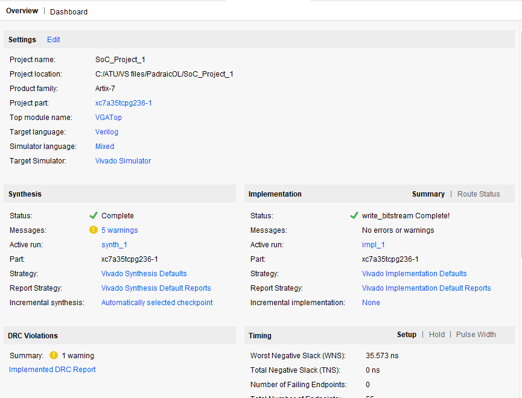
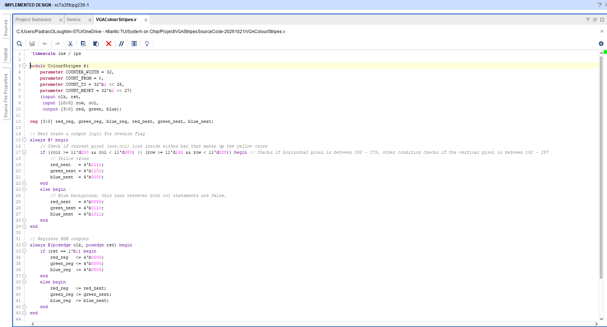

In this SoC Project, with help from labs and lectures we developed and displayed custom graphics on a 640x480 display

I am adding a test sentence here at 14:55 on 21/10/26.

## **Template VGA Design**
### **Project Set-Up**
Each Student was given a template folder that included the Basys3_Master constraints file, and testbench, ColourStripes VGA synch and VGA top files. Using the template ColourStripes file, students could edit the code to include static or dynamic images. To test this, the Testbench file simulates the inputs and outputs and tests them before sending the data to the FPGA, the VGA Sync file handles the timing of the image to the screen, and the ColourStripes file handles the design of what is displayed to the screen.

### **Template Code**
We were given a stripes and colour cycle source code file with a VGA Top and TestBench file that showed colours of black, blue, green, cyan, red, purple, yellow and white. The VGA interface changes the digital image data with an analogue voltage system. 
### **Simulation**
To simulate the project, we're using vivado. We write a design to the ColourStripes module which drives the module inputs using a TestBench file. This testbench generates a clock, and feed values on both sides of the bar, creating the picture. 
### **Synthesis**
The synthesize process turns the verilog code into logic that the hardware can understand. Then it is implemented onto the Artix-7 chip. Functions such as "always @*" map to logic by becoming combinational gates that map to lookup tables. Implementation further cleans up code, and connects the design using the chips wiring using flip-flops.

## **My VGA Design Edit**
My VGA Design was to display a static image of he Swedish flag, I believed this to be a simple task, but I was unsure of how to display different coloured pixels that overlap in a cross-section. The template code provided had stripes that almost worked as vertical stripes, but none overlapped each other. I believed this feature to be difficult to implement into this project.  
### **Code Adaptation**

In the above image, I changed the code to match my desired output. Firstly, the state logic altered the entire background of the image. The way it functioned was that the "if" statement checks if the current row or column pixel in either the horizontal or vertical section is between a set value, and if it was, that pixel was to be coloured yellow, then an "else" statement runs and fills the rest of the pixels with blue, creating the blue background.
### **Simulation**
Show how you simulated your own design. Are there any things to note? Demonstrate your understanding. Add a screenshot. Guideline: 1-2 short paragraphs.
### **Synthesis**
Describe the synthesis & implementation outputs for your design, are there any differences to that of the original design? Guideline 1-2 short paragraphs.
### **Demonstration**
If you get your own design working on the Basys3 board, take a picture! Guideline: 1-2 sentences.

## **More Markdown Basics**
First I tested the board with a black and white striped screen to troubleshoot problems I had encountered, before moving on to the flag design.
